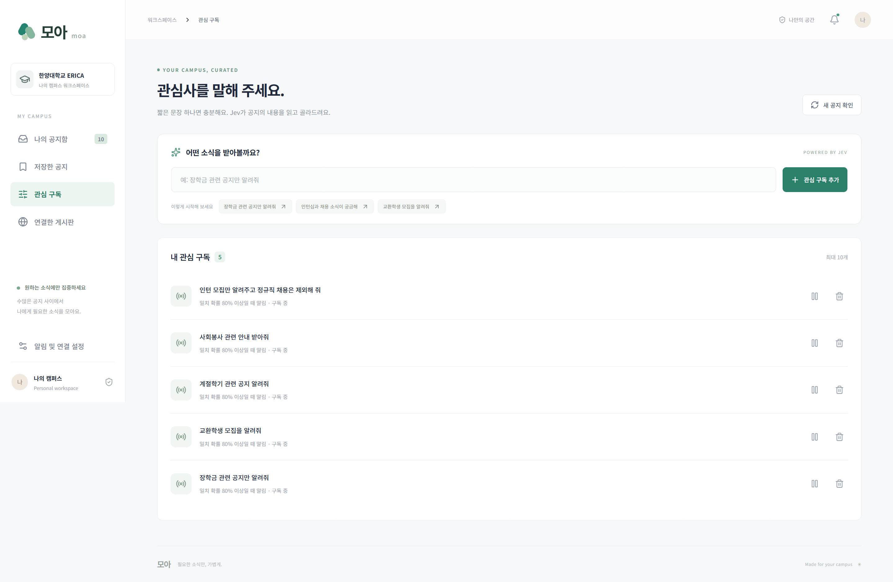

# 모아: Jev 기반 개인 맞춤형 대학 공지 알림 시스템

**과목명:** 자연어처리  
**작성자:** 이승준, 이찬샘, 장기준  


## 1. 프로젝트 개요

대학 홈페이지에는 장학금, 채용, 학사 일정, 국제교류 등 다양한 공지가 지속적으로 게시된다. 학생들은 수많은 공지 중 자신에게 필요한 정보를 찾기 위해 제목과 본문을 직접 확인해야 하며, 공지가 학교·단과대학·학과 게시판에 분산되어 있어 여러 홈페이지를 반복해서 방문해야 한다. 이 과정에서 관심 있는 공지를 놓치거나 신청 기간이 지난 뒤 정보를 확인할 수 있다는 문제가 있다.

‘모아’는 이러한 정보 탐색의 부담을 줄이기 위해 개발한 개인 맞춤형 대학 공지 알림 웹 애플리케이션이다. 사용자가 “장학금 관련 공지만 알려줘”, “인턴 모집만, 정규직 채용은 제외”처럼 관심 카테고리를 자연어로 등록하면, 여러 게시판에서 수집한 공지 중 해당 카테고리에 맞는 소식을 모아 제공한다. 사용자의 관심사에는 포함 조건과 제외 조건이 함께 들어갈 수 있으므로, 공지의 내용을 읽고 조건에 부합하는지 판단하는 역할에 Jev를 활용하였다.

시스템은 수집한 공지의 제목과 본문을 Jev에 전달하여 구독 카테고리별 부합 확률을 얻고, 이를 바탕으로 맞춤 공지와 검토가 필요한 공지를 구분한다. 이 프로젝트를 통해 학생이 공지를 찾는 데 들이는 노력을 줄이고, 자신의 관심사와 관련된 정보를 한곳에서 확인할 수 있도록 하는 것을 목표로 한다.

## 2. 문제 정의와 요구사항

### 2.1 해결하려는 문제

대학의 공지사항은 학교, 단과대학, 학과 등 여러 홈페이지에 분산되어 있다. 학생은 장학금, 인턴십, 교환학생, 계절학기 등의 정보를 확인하기 위해 여러 게시판을 직접 방문해야 한다. 또한 하나의 게시판에도 서로 다른 목적의 공지가 함께 게시되므로, 필요한 내용을 찾기 위해 제목과 본문을 반복해서 읽어야 한다.

단순한 키워드 검색만으로는 사용자의 조건을 충분히 표현하기 어렵다. 예를 들어 “인턴 모집만 알려주고 정규직 채용은 제외해 달라”는 요청에는 포함 조건과 제외 조건이 함께 있다. 제목에 ‘채용’이 있다는 사실만으로 이 조건에 해당하는지 판단하기 어렵다.

이에 본 프로젝트에서는 사용자가 원하는 내용을 문장으로 등록하고, 공지의 제목과 본문을 함께 비교하여 관련성을 판단하는 방식을 선택하였다. 판단이 불확실하거나 본문 정보가 부족한 경우에는 사용자가 직접 확인할 수 있도록 검토함을 두었다.

### 2.2 주요 요구사항

| 요구사항 | 구현 내용 |
|---|---|
| 자연어 관심 카테고리 등록 | 관심사를 문장으로 입력하고 구독 조건으로 저장 |
| 여러 게시판 연결 | HTML 게시판과 RSS/Atom 피드 지원 |
| 공지 본문 확보 | 개별 원문 페이지에서 본문 영역을 추출 |
| 개인 맞춤 판정 | 공지마다 활성화된 구독 조건을 Jev로 평가 |
| 판정 결과 구분 | 맞춤 공지, 검토 필요, 조건과 다름, 분류 대기 표시 |
| 판정 수치 확인 | 카드에 최고 관련도, 상세 화면에 구독별 확률 표시 |
| 알림과 보관 | 앱 안 알림함, 읽음 처리, 맞춤 공지 저장, 브라우저 알림 |
| 반복 확인 | 수동 확인과 자동 확인 지원 |
| 사용자별 데이터 관리 | 구독·판정·알림을 사용자별로 저장하고 조회 |

활용 대상은 특정 학사 정보나 진로 정보를 지속적으로 확인해야 하는 학생이다. 원하는 조건을 변경하면 같은 수집 구조를 장학금, 취업, 국제교류, 봉사활동 등 다양한 관심사에 적용할 수 있다.

그림 1은 이번 검증에 사용한 관심 구독 화면이다. “인턴 모집만 알려주고 정규직 채용은 제외해 줘”, 사회봉사, 계절학기, 교환학생, 장학금의 다섯 카테고리가 등록되어 있다.




*그림 1. 포함·제외 조건을 담은 인턴 구독과 네 가지 다른 관심 구독. 사용자 제공 최신 캡처.*

## 3. 시스템 구조와 구현 방식

### 3.1 전체 처리 흐름

```text
학교·단과대학 공지사항
        ↓
공지 목록 수집
        ↓
개별 공지 본문 추출과 추출 상태 기록
        ↓
공지 제목·본문·게시일 + 사용자 구독 카테고리
        ↓
Jev의 구독별 부합 확률 반환
        ↓
앱의 임계값 및 본문 상태에 따른 분류
        ↓
데이터베이스 저장
        ↓
맞춤 공지함·검토함·앱 안 알림·브라우저 알림
```

먼저 지정한 게시판에서 공지를 가져오고, 이후 각 사용자의 구독 조건(카테고리)에 맞는지 평가한다. 따라서 ‘전체 수집’에는 관심 조건과 다른 공지도 포함될 수 있고, ‘맞춤 공지’에는 일치로 판정된 공지가 표시된다.


### 3.2 기술 구성과 데이터 저장

| 구분 | 사용 기술 | 역할 |
|---|---|---|
| 사용자 화면 | React, TypeScript, Vinext | 구독 관리, 공지 목록, 상세 화면, 설정 |
| 서버 | Cloudflare Workers | 수집·판정 요청 처리와 사용자별 API |
| 데이터베이스 | Cloudflare D1, SQLite 기반 | 게시판, 공지, 구독, 판정, 알림 저장 |
| 문서 분석 | Cheerio | HTML과 RSS/Atom 구조 분석 |
| 의사결정 모델 | TypeSafe Jev API | 구독 카테고리별 공지 부합 확률 산출 |
| 배포 | Sites | 웹 애플리케이션 배포 및 접근 관리 |

### 3.3 연결 가능한 게시판 예시

현재 테스트용으로 연결한 게시판 목록은 다음과 같다.
- 소프트웨어융합대학 공지사항
- 공학대학 공지사항
- 경상대학 취업정보

원하는 공지사항 게시판을 자유롭게 등록할 수 있다.

### 3.4 공지 본문 추출

본문 추출은 공지 페이지에서 실제 공지 내용에 해당하는 텍스트를 가져오는 과정이다. 이 결과가 Jev의 입력이 되므로, 불필요한 메뉴를 제거하고 본문을 올바르게 선택하는 것이 중요하다.

본문 영역을 찾으면 스크립트, 스타일, 메뉴, 머리말·꼬리말, 입력 폼 등을 제거한다. 줄바꿈 태그와 문단·목록 요소에는 줄바꿈을 반영하고, HTML 태그를 제외한 텍스트를 추출한다. 마지막으로 반복되는 공백과 빈 줄을 정리한다.

예를 들어 다음 HTML은:

```html
<div class="view_content">
  <p>장학금 신청 안내</p>
  <p>신청 기간: 11월 17일 ~ 11월 24일</p>
  <p>지원 대상: 재학생</p>
</div>
```

다음과 같은 텍스트로 변환된다.

```text
장학금 신청 안내
신청 기간: 11월 17일 ~ 11월 24일
지원 대상: 재학생
```

## 4. Jev 활용 설계

### 4.1 Jev의 역할과 선택 이유

이 프로젝트에서 필요한 판단은 “이 공지가 사용자의 알림 조건에 부합하는가?”이다. Jev의 Noul 형식은 예·아니오 질문에 대해 ‘예’일 확률을 반환하므로, 구독 조건별 분류에 사용하였다.

사용자는 단어뿐 아니라 포함·제외 조건이 들어간 문장을 등록할 수 있다. 프로그램은 이 문장을 Jev 질문에 반영하고, 제목과 본문을 근거로 판단하도록 요청한다.

이를 통해 자연어 조건을 처리하는 구조를 구현하였다. 키워드 검색과의 정량적 비교 실험은 수행하지 않았으므로, 정확도나 성능 우위를 수치로 주장하지 않는다.

### 4.2 입력과 출력

Jev 요청에는 공지 정보와 구독 조건을 구분하여 넣는다.

| 요청 항목 | 전달 내용 |
|---|---|
| `model` | `jev-latest` |
| `state` | 공지 제목, 추출한 본문, 게시일 |
| `questions` | 활성화된 구독 조건별 Noul 질문 |

이번 사례에서는 “인턴 모집만 알려주고 정규직 채용은 제외해 줘”라는 문장 전체를 질문에 넣었다. 프로그램이 ‘인턴’이나 ‘채용’이라는 단어만 추려 전달하거나, 해당 단어의 포함 여부만으로 일치 여부를 결정하는 구조가 아니다. 최종 판단에는 모집 형태를 설명하는 본문과 제외 조건을 함께 사용하도록 요청하였다.

공지 하나에 여러 구독 조건이 있으면 한 번의 요청에 여러 질문을 함께 전달한다. 응답은 질문별로 받으며, 반환된 확률과 실제 응답 모델명을 저장한다.

Noul의 `noul` 값은 조건에 부합할 확률이다. 별도의 `confidence` 필드는 없으므로, 화면에는 이를 백분율로 변환하여 ‘Jev 관련도’로 표시하였다. 값의 의미는 관련성의 강도 자체보다 **구독 조건에 부합한다고 모델이 판단한 확률**에 해당한다.

### 4.3 임계값과 분류 기준

현재 기본 구독 임계값은 0.8이다. 본문 상태가 `full`인 경우 다음 기준을 적용한다.

| Jev 반환 확률 | 분류 |
|---|---|
| 0.8 이상 | 관심 조건 일치 |
| 0.2 초과, 0.8 미만 | 검토 필요 |
| 0.2 이하 | 조건과 다름 |

본문 상태가 `attachment`, `short`, `summary`이면 확률과 관계없이 검토 대상으로 처리한다.

임계값은 Jev가 자동으로 결정하는 값이 아니라 애플리케이션에서 적용하는 기준이다.

각 구독은 독립적으로 평가한다. 예를 들어 같은 공지에 대해 장학금 조건이 92%, 인턴십 조건이 85%라면 두 조건에 모두 일치할 수 있다.

## 5. 개발 과정의 문제와 해결

### 5.1 게시판마다 다른 구조를 어떻게 연결할 것인가

**막힌 부분:** 소프트웨어융합대학 게시판을 기준으로 만든 수집 규칙을 공학대학 게시판에 그대로 적용할 수 없었다. 게시판 주소만 바꾸어서는 공지 링크와 본문 위치를 동일하게 찾을 수 없기 때문이다.

**시도한 방법:** 공학대학의 실제 페이지 구조와 제공 기능을 확인하였다. 이 과정에서 공식 RSS/Atom 피드 주소를 확인하고, HTML 목록을 직접 분석하는 방식과 피드를 사용하는 방식을 구분하였다.

**적용한 해결책:** 게시판별로 수집 방식, 공지 링크 선택자, 본문 선택자를 저장하도록 구성하였다. 공학대학은 RSS/Atom으로 목록을 읽고, 원문이 필요한 경우에는 공학대학에 맞는 본문 선택자를 사용하도록 연결하였다.

### 5.2 공지는 수집되었지만 선정 이유를 알기 어려운 문제

**막힌 부분:** 초기 버전에서는 공지가 ‘일치’, ‘검토 필요’, ‘조건과 다름’으로 분류된 결과만 보여주었다. 이 때문에 사용자는 Jev가 해당 공지를 자신의 관심 조건에 얼마나 부합한다고 판단했는지 알기 어려웠다.

**시도한 방법:** 분류 결과를 수치로도 확인할 수 있도록 Jev 응답의 부합 확률을 활용하는 방법을 검토하였다. 같은 분류에 속한 공지라도 확률값을 함께 보여주면 판단 결과의 차이를 더 쉽게 이해할 수 있다고 보았다.

**적용한 해결책:** Jev가 반환한 부합 확률을 백분율로 변환하여 ‘Jev 관련도’로 표시하였다. 공지 목록에는 가장 높은 관련도와 해당 구독 조건을 보여주고, 상세 화면에서는 구독별 관련도를 각각 확인할 수 있도록 하였다.

**확인 결과:** 최신 상세 화면에서 같은 인턴 구독에 대한 네오플 공지의 원본 응답은 0.88, 동진쎄미켐 공지의 원본 응답은 0.03으로 표시된다. 각 값이 88%, 3%로 변환되어 표시되고 실제 응답 모델명도 확인할 수 있다. 해당 결과는 그림 4·5에 제시하였다.

## 6. 실행 결과와 검증

### 6.1 검증 조건과 절차

이번 실행 검증은 ‘채용 관련 공지인가’라는 넓은 주제 분류를 넘어, **‘인턴 모집은 포함하고 정규직 채용은 제외한다’는 구체적인 조건을 적용할 수 있는가**에 초점을 맞추었다.

| 항목 | 검증에 사용한 설정 |
|---|---|
| 관심 조건 | 인턴 모집만 알려주고 정규직 채용은 제외해 줘 |
| 일치 처리 임계값 | 0.8, 화면 표시 80% |
| 입력 | 수집한 공지 제목·본문·게시일과 구독 문장 |
| 실제 응답 모델 | 두 상세 화면 모두 `jev-1.14.0` |
| 비교 방식 | 서로 다른 두 채용 공지에 동일한 구독 조건을 적용한 결과 확인 |

### 6.2 포함 조건에 부합한 사례: 네오플 채용연계형 인턴

경상대학 취업정보 게시판에서 수집한 **「[2027 네오플 채용연계형 인턴]」** 공지의 게시일은 2026년 11월 17일이다. 원문 본문에는 실제 프로젝트에 합류하는 채용연계형 인턴이라는 설명과 게임기획 모집 분야가 제시되어 있었다.

| 구독 조건 | 원본 응답 | 화면 표시 |
|---|---:|---:|
| 인턴 모집만 알려주고 정규직 채용은 제외해 줘 | 0.88 | 88% |
| 계절학기 관련 공지 알려줘 | 0.05 | 5% |
| 사회봉사 관련 안내 받아줘 | 0.03 | 3% |
| 장학금 관련 공지만 알려줘 | 0.02 | 2% |
| 교환학생 모집을 알려줘 | 0.02 | 2% |

인턴 구독에 대한 부합 확률은 88%로 기본 임계값 80%를 넘었다. 11월 17일 연결 검증에서는 해당 공지가 ‘관심 조건 일치’로 표시되는 것도 확인하였다. 나머지 네 구독은 모두 5% 이하로, 같은 공지에 대해서도 관심 조건에 따라 서로 다른 확률이 반환되었다.

‘채용연계형 인턴’은 향후 정규직 전환 가능성과 현재 모집하는 인턴 형태를 구분해서 읽어야 하는 사례이다. 이번 결과에서는 Jev가 해당 공지를 인턴 구독에 부합하는 것으로 평가하였다. 만약 사용자가 채용연계형 인턴까지 제외하려면 그 조건을 별도로 명시해야 한다.


*그림 2. 인턴 포함·정규직 제외 조건에 88%를 반환한 네오플 인턴 공지. 원본 응답 0.88과 실제 모델 `jev-1.14.0`이 표시된다. 사용자 제공 최신 캡처.*

### 6.3 제외 조건을 비교한 사례: 동진쎄미켐 신입·경력 채용

비교 대상으로 사용자가 선택한 공지는 소프트웨어융합대학의 **「[동진쎄미켐] 2026년 11월 신입/경력 정기채용 (~11/15(일))」**이며, 게시일은 2026년 11월 6일이다. 인턴 모집 공지와 일반 신입·경력 채용 공지를 같은 조건으로 구분하는지 확인하기 위한 사례이다.

| 구독 조건 | 원본 응답 | 화면 표시 |
|---|---:|---:|
| 계절학기 관련 공지 알려줘 | 0.03 | 3% |
| 사회봉사 관련 안내 받아줘 | 0.03 | 3% |
| 인턴 모집만 알려주고 정규직 채용은 제외해 줘 | 0.03 | 3% |
| 장학금 관련 공지만 알려줘 | 0.02 | 2% |
| 교환학생 모집을 알려줘 | 0.02 | 2% |

동일한 인턴 구독에 대한 부합 확률은 3%였다. 이는 알림 임계값 80%에 미치지 못하며, 본문 상태가 `full`일 때 적용하는 ‘조건과 다름’ 구간인 20% 이하에 해당한다. 다른 구독도 모두 3% 이하이므로, 이 캡처에 표시된 조건 중 일치 임계값을 넘는 조건은 없다.


*그림 3. 네오플 공지에 적용한 것과 동일한 인턴 구독에 3%를 반환한 신입·경력 채용 공지. 원본 응답은 0.03, 실제 모델은 `jev-1.14.0`이다. 사용자 제공 최신 캡처.*

### 6.4 같은 조건에 대한 두 사례의 비교

| 비교 항목 | 네오플 공지 | 동진쎄미켐 공지 |
|---|---|---|
| 공지의 모집 내용 | 채용연계형 인턴 | 신입·경력 정기채용 |
| 출처 | 경상대학 취업정보 | 소프트웨어융합대학 |
| 적용한 구독 | 인턴 포함·정규직 제외 | 인턴 포함·정규직 제외 |
| 해당 구독의 부합 확률 | **88%** | **3%** |
| 80% 임계값 충족 여부 | 충족 | 미충족 |
| 확인한 결과 | 상세 점수 확인 및 연결 검증 시 맞춤 공지 표시 | 상세 점수 확인, 표시된 모든 구독이 알림 임계값 미만 |
| 근거 화면 | 그림 2 | 그림 3 |

이 비교는 자연어의 포함·제외 조건을 Jev에 전달하고, 응답을 저장하여 사용자에게 제시하는 흐름이 실제 공지에서 동작함을 보여준다. 서로 다른 게시판의 공지를 같은 구독 조건으로 평가할 수 있다는 점도 확인하였다.

### 6.5 사용 절차

1. 앱에 로그인하고 Jev API 키를 연결한다.
2. 관심 구독에 “인턴 모집만 알려주고 정규직 채용은 제외해 줘”와 같이 원하는 조건을 문장으로 등록한다.
3. 연결한 게시판을 확인한 뒤 ‘새 공지 확인’을 실행한다.
4. ‘전체 수집’에서 수집 결과를 확인한다.
5. ‘맞춤 공지’와 ‘검토 필요’에서 판정 결과를 확인한다.
6. 공지를 열어 구독별 점수와 본문을 확인하고, 필요한 경우 학교 원문으로 이동한다.
7. 자동 확인과 브라우저 알림을 활성화한다.

## 7. 한계와 개선 방향- 분류 정확도와 임계값 평가

현재는 실제 응답 사례와 기능 테스트를 통해 동작을 확인하였다. 사람이 정답을 붙인 공지 집합으로 정확도, 정밀도, 재현율을 측정한 단계는 아니다.

후속 단계에서는 구독 조건과 공지의 조합에 대해 사람이 일치·불일치 정답을 작성하고, Jev 결과와 비교할 계획이다. 관련 없는 알림을 보내는 경우와 중요한 공지를 놓치는 경우를 나누어 분석하고, 이 결과를 바탕으로 현재 임계값 0.8을 조정할 수 있다. 키워드 기반 방식과 같은 데이터로 비교하면 Jev를 활용했을 때의 차이도 평가할 수 있다.

특히 인턴만 모집하는 공지, 정규직만 모집하는 공지, 인턴과 정규직을 함께 모집하는 공지, 채용연계형 인턴 공지를 나누어 평가할 필요가 있다. 이번 두 사례의 차이를 더 다양한 고용 형태에서도 일관되게 재현할 수 있는지 확인하는 것이 다음 과제이다.

## 8. 결론과 개발 도구 활용

본 프로젝트에서는 Jev를 활용하여 사용자의 자연어 구독 조건과 대학 공지의 부합 여부를 판단하는 웹 애플리케이션을 구현하였다. 

모델의 확률을 보여줄 때에는 그 값의 의미와 실제 분류 기준을 구분하는 것도 필요했다. 이를 위해 구독별 확률과 원본 응답을 표시하고, 본문 정보가 부족한 공지는 검토 대상으로 처리하였다. 최신 실행 화면에서는 같은 “인턴 모집만 알려주고 정규직 채용은 제외해 줘” 조건에 대해 네오플 인턴 공지는 88%, 동진쎄미켐 신입·경력 채용 공지는 3%로 표시되는 것을 확인하였다. 이를 통해 넓은 주제 분류뿐 아니라 포함·제외 조건을 담은 요청의 판정 결과도 확인할 수 있도록 하였다.

이번 구현은 Jev를 이용한 개인 맞춤형 공지 수집 서비스가 실제로 학생들이 사용할 만한 수준을 갖추었다는 데 의의가 있다. 

### 파일 구성


```text
보고서.md
report-images-v2/
  01-subscriptions-intern-only.png
  02-internship-match.png
  03-regular-recruitment-scores.png
```
